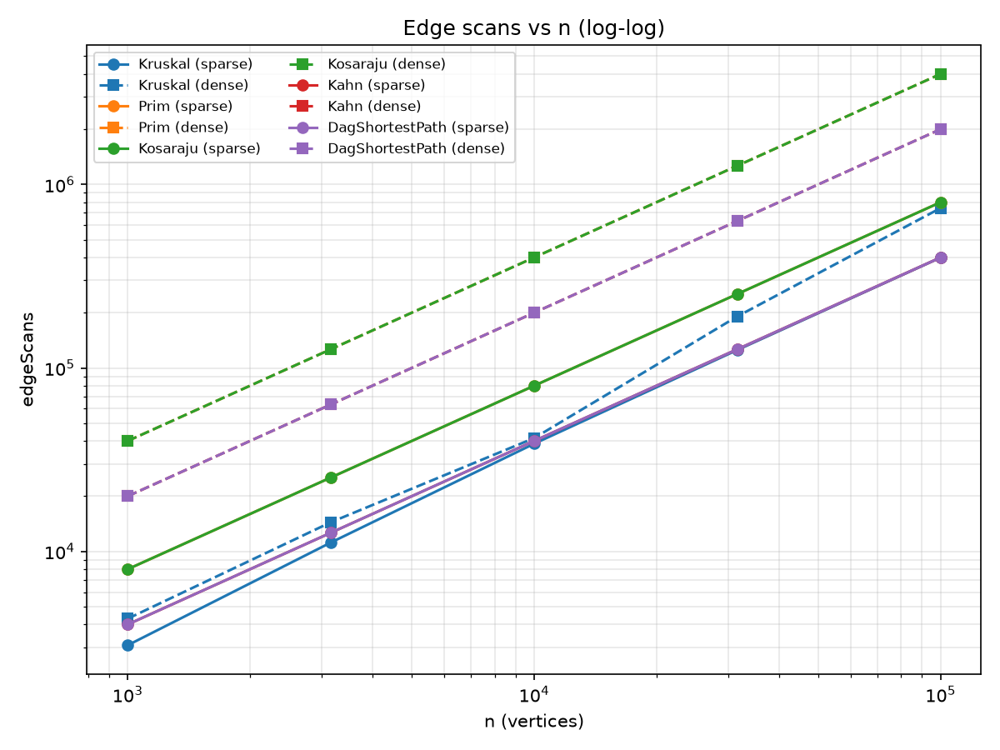
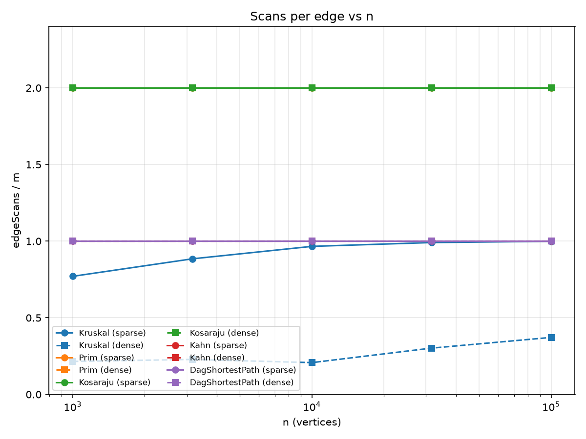
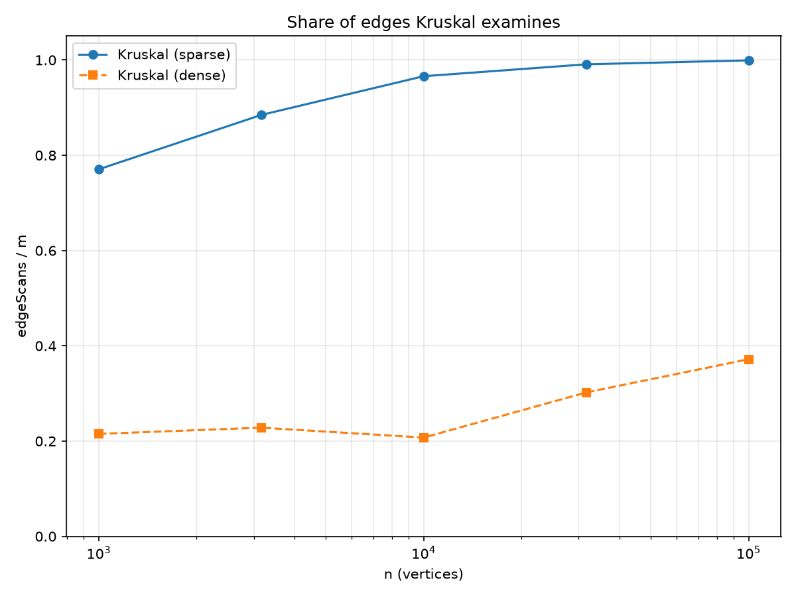

# Assignment 3: Graphs – DSU, MST, SCC and Shortest Paths in DAGs

**Course:** Design and Analysis of Algorithms  
**Author:** Zhursin Sirnebayev, SE-2509  
**Repository:** https://github.com/sirnebaevzursin-maker/daa3.git (branch `main`, tag `v1.0`)

## 0. Overview

One `Graph` class (adjacency list, vertices `0..n-1`, `int` weights, directed or undirected) is used by all six algorithms: DSU, Kruskal, Prim, Kosaraju (iterative DFS), Kahn and shortest paths in a DAG. Self-loops, parallel edges, isolated vertices and disconnected graphs are handled without exceptions (MST returns a spanning forest and the number of components). Every number in this report comes from counters incremented inside the algorithms (`dsuOps`, `edgeScans`, `comparisons`, `maxDepth`), so it is identical on every machine. The benchmark generates ten graphs with `new Random(42)` (n = 1 000, 3 162, 10 000, 31 623, 100 000; sparse m = 4n and dense m = 20n) and checks itself: Kruskal and Prim must give the same weight, every topological order is validated, and all results must equal the reference table. All ten graphs match exactly:

| n / m | MST weight | SCC count | Sum of DAG distances |
|---|---|---|---|
| 1 000 / 4 000 | 147 970 | 27 | 396 274 |
| 1 000 / 20 000 | 30 363 | 1 | 252 411 |
| 3 162 / 12 648 | 468 911 | 137 | 1 271 911 |
| 3 162 / 63 240 | 97 589 | 1 | 723 157 |
| 10 000 / 40 000 | 1 486 139 | 373 | 3 941 828 |
| 10 000 / 200 000 | 309 550 | 1 | 2 381 342 |
| 31 623 / 126 492 | 4 715 515 | 1 188 | 12 551 891 |
| 31 623 / 632 460 | 968 517 | 1 | 7 376 612 |
| 100 000 / 400 000 | 15 012 094 | 3 923 | 40 096 539 |
| 100 000 / 2 000 000 | 3 056 681 | 1 | 23 512 087 |

## 1. Complexity table

V is the number of vertices, E the number of edges.

| Algorithm | Time | Extra space | Justification |
|---|---|---|---|
| DSU `find` / `union` | O(α(n)) amortized | O(n) | Union by rank keeps every tree O(log n) high and path compression flattens it; together the amortized cost per operation is the inverse Ackermann function. Arrays `parent` and `rank`. |
| Kruskal | O(E log E) | O(E + V) | Sorting the E edges dominates; the E `find` and V-1 `union` calls cost O(E α(V)). Extra space: the sorted copy of the edges and the DSU arrays. |
| Prim (binary heap, lazy) | O(E log E) = O(E log V) | O(E + V) | Every edge is pushed at most once from each endpoint and each push or pop costs O(log E). The heap can hold up to 2E entries; entries pointing into the tree are skipped. |
| Kosaraju | O(V + E) | O(V + E) | Two DFS passes, every edge looked at once per pass (2E scans). The reversed graph needs O(V + E), the explicit stack O(V). |
| Kahn | O(V + E) | O(V) | In-degrees and a queue; every vertex leaves the queue once and every edge is scanned once. |
| DAG shortest paths | O(V + E) | O(V) | One pass over the topological order; every edge is relaxed once. Arrays `dist` and `parent`. |

## 2. Counters vs formulas

Each ratio is a measured counter divided by the formula of its complexity class. If the ratio stays constant while n grows 100 times, the counter follows the formula. The five values in a cell are for n = 1 000, 3 162, 10 000, 31 623 and 100 000. Sparse is m = 4n, dense is m = 20n.

| Algorithm and ratio | Sparse | Dense |
|---|---|---|
| Kosaraju: `edgeScans / (V+E)` | 1.60, 1.60, 1.60, 1.60, 1.60 | 1.90, 1.90, 1.90, 1.90, 1.90 |
| Kahn: `edgeScans / (V+E)` | 0.80, 0.80, 0.80, 0.80, 0.80 | 0.95, 0.95, 0.95, 0.95, 0.95 |
| DAG paths: `edgeScans / E` | 1.00 at every size | 1.00 at every size |
| Prim: `edgeScans / E` | 2.00 at every size | 2.00 at every size |
| Prim: `comparisons / (E log₂E)` | 1.83, 1.87, 1.90, 1.92, 1.93 | 1.83, 1.85, 1.87, 1.88, 1.89 |
| Kruskal: `dsuOps / E` | 1.79, 2.02, 2.18, 2.23, 2.25 | 0.48, 0.51, 0.47, 0.65, 0.79 |
| Kruskal: `dsuOps / edgeScans` | 2.32, 2.28, 2.26, 2.25, 2.25 | 2.23, 2.22, 2.24, 2.17, 2.13 |
| Kruskal: `comparisons / (E log₂E)` | 0.89, 0.91, 0.87, 0.81, 0.75 | 0.90, 0.85, 0.78, 0.72, 0.67 |

What the table shows:

- Kosaraju scans exactly 2m edges and Kahn and the DAG relaxation exactly m, so their ratios are constants (1.60 = 2m / (n + m) for m = 4n and 1.90 for m = 20n). The benchmark stops with an error if these identities break.
- Kruskal's `dsuOps / E` is nearly constant on sparse graphs (it settles at 2.25) but grows on dense ones. The reason is the early stop: Kruskal quits after n-1 accepted edges and examines only part of the list (see section 4). The quantity that stays constant is `dsuOps` per *examined* edge, about 2.1 to 2.3: two `find` calls per examined edge plus one `union` for each accepted edge.
- The comparison counts of the sorts and the heap stay within a constant factor of E log₂E. For Kruskal the ratio is below one and falls slowly, because the sort does not need its worst case and the early stop does not change the sort itself. For Prim the ratio rises slowly to a constant of about 1.9.
- The explicit-stack depth of Kosaraju (`maxDepth`) grows linearly with n: 626, 1 871, 5 925, 18 671, 59 394 on sparse and 916, 2 920, 9 217, 29 073, 91 920 on dense graphs. A recursive DFS would overflow the JVM stack at such depths; the explicit stack does not.

## 3. Slope check

On log-log axes a straight line of slope 1 means linear work. The least-squares slope of `edgeScans` against n is:

| Algorithm | Sparse | Dense |
|---|---|---|
| Prim, Kosaraju, Kahn, DAG shortest paths | **1.000** | **1.000** |
| Kruskal | **1.055** | **1.119** |

The four traversals give exactly 1.00. Kruskal is steeper, which is expected: the share of the edge list it has to examine grows with n (plot 3), and the sort adds the log factor to the work (the slope of its `comparisons` is 1.06 on sparse and 1.02 on dense graphs).

## 4. Correctness arguments

### 4.1 Cut property (Kruskal and Prim)

A cut splits the vertices into two non-empty sets S and V∖S, and the cut property says that the lightest edge e crossing it belongs to some minimum spanning tree. To see it, take any MST T that does not contain e; adding e to T closes a cycle. This cycle crosses the cut at least once more, through an edge f ≠ e, and w(e) ≤ w(f) because e is the lightest crossing edge. Replacing f by e gives a spanning tree that weighs no more than T, so it is also minimal and contains e (with equal weights the trees may differ, but the total weight is the same). Kruskal uses the property with the cut "the component of u against the rest": any lighter edge leaving that component was processed earlier and would have been accepted, so the next accepted edge is the lightest one crossing the cut. Prim uses it with S equal to the current tree, because the heap returns the lightest edge leaving the tree. By induction the chosen edges are always a subset of some MST, and with n-1 edges they form an MST. On a disconnected graph the same argument holds in each component and gives a minimum spanning forest.

### 4.2 Induction on the topological order (DAG shortest paths)

Let v₁, v₂, …, vₙ be a topological order; every vertex with in-degree 0 starts at distance 0 (the virtual super-source). The claim is that when the pass reaches vᵢ, `dist[vᵢ]` is already the true shortest distance and it is never changed again. Base: v₁ has no incoming edge, because the tail of such an edge would stand before it, so v₁ is a source and its distance 0 is correct. Step: every path to vᵢ ends with an edge (vⱼ, vᵢ) with j < i, because the order respects all edges. By the induction hypothesis `dist[vⱼ]` is final when vⱼ is processed, and the relaxation of (vⱼ, vᵢ) happens at that moment. So when vᵢ is reached, all its incoming edges have been relaxed and `dist[vᵢ]` is the minimum over them (or 0 for a source), which is exactly the shortest distance. Every edge is relaxed once, so a single pass is enough and the cost is O(V + E).

**Why negative weights are allowed in a DAG but not in a general graph.** The proof never uses the sign of a weight. It uses only that a vertex is finalized after all its predecessors, and a topological order guarantees that. Dijkstra, in contrast, finalizes the vertex with the smallest tentative distance and assumes that a longer-looking path cannot become shorter later, which a negative edge breaks. In a general graph a negative cycle makes shortest paths undefined, because every round along the cycle lowers the distance. A DAG has no cycles, so this cannot happen.

## 5. Which algorithm when

| Situation | Choice | Why |
|---|---|---|
| MST, **sparse** graph (m ≈ 4n), edges as a **list** | **Kruskal** | The list is ready to be sorted, the DSU is cheap, and on sparse graphs Kruskal examines almost every edge anyway (99.9% at n = 100 000), so nothing is wasted. |
| MST, **dense** graph (m ≈ 20n) | **Kruskal** (with the early stop) | It examines only 21–37% of the edges, because it quits after n-1 accepted edges. Prim on an **adjacency list** scans every edge twice: 4 000 000 scans against 743 572 for Kruskal at n = 100 000. |
| MST, very dense graph (m close to n²) stored as a matrix | **Prim** with an array instead of a heap | O(V²) with no sorting of ~n² edges and no DSU. |
| MST, graph may be **disconnected** | Either | Both return a spanning forest; Prim is restarted from each unvisited vertex and counts the components. |
| Directed graph, which vertices reach each other (deadlock groups) | **Kosaraju** | O(V + E) with an iterative DFS; it needs the reversed graph and so scans 2E edges. |
| Order of dependent jobs, **cycle possible** | **Kahn** | O(V + E); if fewer than n vertices leave the queue, the graph has a cycle and that is reported instead of a wrong order. |
| Shortest paths, graph is a **DAG** (cycle impossible), weights may be negative | **DAG relaxation** | One O(V + E) pass in topological order, no heap. Dijkstra would cost O((V + E) log V) and is wrong with negative edges. |
| Shortest paths, **cycle possible**, weights non-negative | Dijkstra (not implemented here) | Relaxation in topological order needs an acyclic graph. |
| Shortest paths, cycle possible, **negative weights** | Bellman-Ford (not implemented here) | O(VE), but it also detects negative cycles. |

## 6. Plots

*Plot 1: `edgeScans` against n, log-log, one line per algorithm and density (solid sparse, dashed dense). Prim and Kosaraju (2m) lie above Kahn and the DAG paths (m), and all four are parallel to a line of slope 1. Kruskal lies lower on dense graphs because of the early stop.*

*Plot 2: `edgeScans / m` against n. The lines of Prim (2), Kosaraju (2), Kahn (1) and the DAG paths (1) are flat, which confirms linear work. Kruskal is the only curve that moves.*

*Plot 3: `edgeScans / m` for Kruskal. On sparse graphs it rises to 1.0 (0.77 to 0.999); on dense graphs it stays between 0.21 and 0.37. This is where each MST algorithm wins: Kruskal profits from the early stop on dense graphs, while on sparse graphs there is nothing left to skip.*

## 7. About running time

The median of 5 runs at n = 100 000 on the dense graph was 610 ms for Kruskal, 2 289 ms for Prim, 550 ms for Kosaraju, 81 ms for Kahn and 67 ms for the DAG paths (on the sparse graph of the same size: 99, 245, 106, 21 and 28 ms). On the smallest graphs every run took only 0.5 to 8.3 ms, which is mostly timer and JIT warm-up noise; Prim was even faster than Kruskal up to n = 3 162 and on the sparse graph with n = 10 000, while Kruskal is faster from n = 31 623 and on dense graphs from n = 10 000. At the largest dense graph Prim is 3.7 times slower than Kruskal, which agrees in direction with its 4 000 000 edge scans and 79 million comparisons against 743 572 scans and 28 million comparisons for Kruskal, but the proportions do not match the counters: Kosaraju scans only twice as many edges as Kahn and still needs about seven times more time, because it also builds the reversed graph and its DFS reads memory in a scattered order, which `edgeScans` does not capture. That is why the times are not the main evidence of this report: they depend on the hardware, the JVM version and its JIT warm-up, the garbage collector and the background load of the laptop, so another machine or even another run gives different numbers, while the counters are the same everywhere, and all conclusions above are drawn from the counters.

## 8. Tests

JUnit 5, 22 tests, all passing. DSU is compared with a naive reference after random unions (and `components()` with the number of sets). Kruskal and Prim give the same weight and exactly n-1 edges on 100 random connected graphs; a disconnected graph gives a forest. Kosaraju is compared with a brute-force BFS from every vertex on random graphs with n ≤ 200. Kahn gives a valid order on random DAGs and detects cycles (including a self-loop). DAG shortest paths are compared with Bellman-Ford on random DAGs with negative weights, and the path restoring is checked. Kosaraju runs on a path and on a cycle of 100 000 vertices without `StackOverflowError`. Four more tests read the input graphs from `data/` (connected, disconnected with a self-loop and parallel edges, cyclic).
